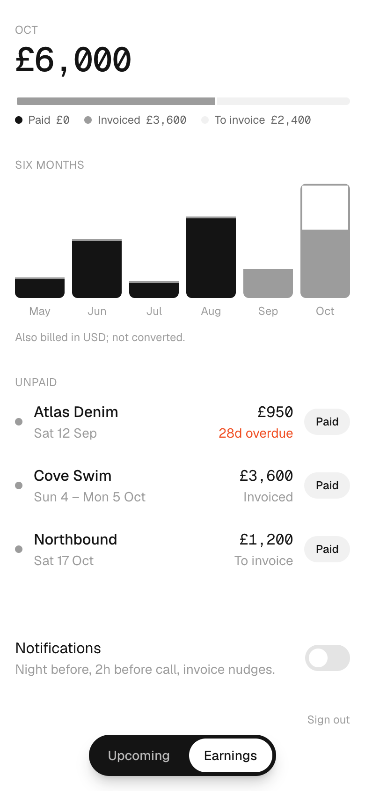
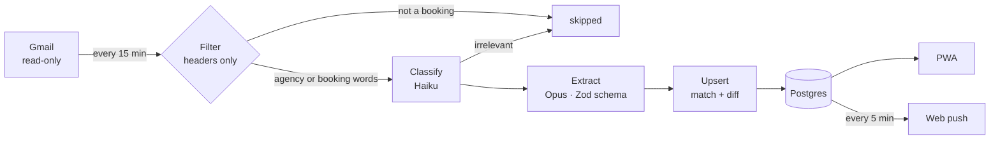

# Callsheet

**Bookings, call times and what I'm owed, read straight from my inbox.**

I work as a model. Jobs, options, travel and payments all arrive by email, and I never logged any of it. Callsheet reads those emails, turns each job into a record, reminds me the night before I'm on set, and shows what's still unpaid.

A booking lands in Gmail. Fifteen minutes later it's in the app with the right date, call time, location and rate.

<table>
  <tr>
    <td><picture><source media="(prefers-color-scheme: dark)" srcset="docs/screenshots/upcoming-dark.png"></picture></td>
    <td><picture><source media="(prefers-color-scheme: dark)" srcset="docs/screenshots/job-dark.png"></picture></td>
    <td><picture><source media="(prefers-color-scheme: dark)" srcset="docs/screenshots/earnings-dark.png"></picture></td>
  </tr>
  <tr>
    <td align="center">Upcoming</td>
    <td align="center">Job</td>
    <td align="center">Earnings</td>
  </tr>
</table>

## How it works

1. **Fetch.** A cron pulls new message ids from the Gmail history API, scope `gmail.readonly`.
2. **Filter.** Only mail from known agency domains, or with booking words in the subject, is opened. Everything else stops at the headers.
3. **Classify.** One cheap model call labels the email: new booking, update, travel, payment or irrelevant.
4. **Extract.** One structured-output call returns the job, travel and payment fields against a strict schema.
5. **Upsert.** The result is matched to an existing job or saved as a new one, and its reminders are scheduled.

## Decisions worth a look

- **No agent in the pipeline.** Two schema-constrained model calls per relevant email; everything else is ordinary, tested code. It's cheap, predictable and easy to debug.
- **Null beats a guess.** The extractor leaves any field it can't read straight from the email empty. Code then re-checks every date, time, zone and currency. Anything missing or doubtful flags the job *Needs review*, with the reasons shown, and one tap clears it.
- **Updates edit, they don't duplicate.** A job is matched by email thread first, then by agency, client and overlapping dates. Moving a call time changes the existing job and pushes "call time 07:00 → 08:30". A field the email doesn't mention never erases a stored one.
- **Reminders in the job's own time zone.** A New York shoot gets its night-before push at 20:00 New York time, and daylight-saving changes are handled. Invoice nudges go the day after wrap, then weekly once overdue, until it's paid.
- **Email bodies are never stored.** Only headers, the Gmail id and the extracted fields are kept, and every job links back to its source email. The Gmail refresh token is encrypted with AES-256-GCM.
- **An eval set, not vibes.** [`fixtures/`](fixtures) holds 22 fictional booking emails with expected output, including messy ones like forwarded threads, weekday-only dates and totals with no day count. `pnpm eval` scores the extractor per field and fails below 90%.

## Design

Mobile-first, installable, no App Store. A white ground with one ink and one accent colour. Geist for text and Geist Mono only for times and money. Status is a dot rather than a pill: solid for confirmed, outlined for a first option, dashed for a second. Navigation is a floating pill. Dark mode follows the system.

## Stack

| | |
|---|---|
| App | Next.js 16 (App Router), React 19, TypeScript, Tailwind 4 |
| Data | Postgres, Drizzle ORM |
| AI | Anthropic SDK with structured outputs, Claude Haiku 5.5 and Opus 5.5 |
| Hosting | Railway: web service, Postgres, two cron services |
| Notifications | Web Push with VAPID, service worker |
| Tests | Vitest against a real Postgres, plus the fixture eval |

## Code tour

| Path | What's there |
|---|---|
| [`src/lib/pipeline.ts`](src/lib/pipeline.ts) | The five steps for one sync run |
| [`src/lib/extract.ts`](src/lib/extract.ts) | Extraction schema, prompt and normalisation |
| [`src/lib/upsert.ts`](src/lib/upsert.ts) | Job matching, change diffs, invoices |
| [`src/lib/reminders.ts`](src/lib/reminders.ts) | Reminder planning in the job's zone |
| [`src/app/(app)`](src/app/(app)) | The three screens |
| [`docs/SPEC.md`](docs/SPEC.md) | The v1 spec |
| [`docs/TASKS.md`](docs/TASKS.md) | Build log, one commit per task |

## Running it

Setup, environment variables, tests and Railway deployment are in [docs/SETUP.md](docs/SETUP.md).

## Status

v1 is built and deployed. Next is phase 2: a chat agent over my data on Telegram. The read-only tool API it will use is already in place: `list_jobs`, `get_job`, `earnings`, `unpaid` and `draft_invoice_chase`, which only returns a draft.
