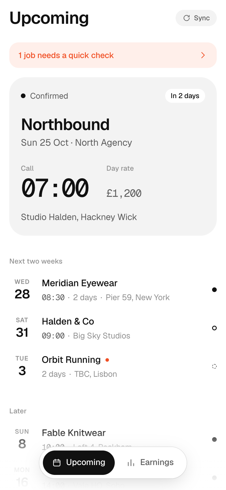
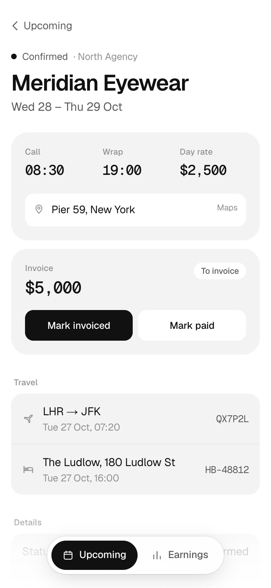
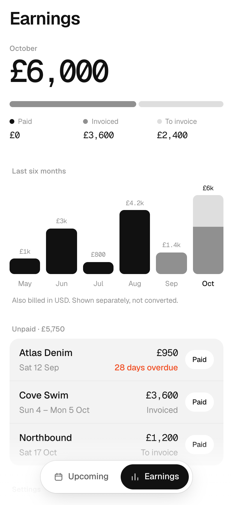

# Callsheet

**Bookings, call times and what I'm owed, read straight from my inbox.**

I work as a model. Jobs, options, travel and payments all arrive by email, and I never logged any of it. Callsheet reads those emails, turns each job into a record, reminds me the night before I'm on set, and shows what's still unpaid.

A booking lands in Gmail. Fifteen minutes later it's in the app with the right date, call time, location and rate.

<table>
  <tr>
    <td><picture><source media="(prefers-color-scheme: dark)" srcset="docs/screens/upcoming-dark.png"></picture></td>
    <td><picture><source media="(prefers-color-scheme: dark)" srcset="docs/screens/job-dark.png"></picture></td>
    <td><picture><source media="(prefers-color-scheme: dark)" srcset="docs/screens/earnings-dark.png"></picture></td>
  </tr>
  <tr>
    <td align="center">Upcoming</td>
    <td align="center">Job</td>
    <td align="center">Earnings</td>
  </tr>
</table>

## How it works

Every 15 minutes a cron pulls new mail from Gmail with read-only access. Anything that isn't from an agency or about a booking is skipped without opening it. The rest goes through two Claude calls, one to classify and one to extract fields against a strict schema. The result updates the matching job or creates a new one, and schedules its push reminders.

- **Null beats a guess.** Fields the email doesn't state are left empty and the job is flagged for review.
- **Updates edit, they don't duplicate.** A moved call time changes the existing job and sends a push saying what changed.
- **Reminders in the job's time zone.** Night before, two hours before call, and invoice nudges until paid.
- **Email bodies are never stored.** Only headers and the extracted fields are kept.

## Stack

Next.js 16, TypeScript, Tailwind, Postgres with Drizzle, Claude Haiku and Opus, web push. Hosted on Railway.

Setup and deployment are in [docs/SETUP.md](docs/SETUP.md). The original spec is in [docs/SPEC.md](docs/SPEC.md).

## Recent changes

**6 November 2026**

- Corrected one client's day rate and currency by hand in my own ledger, and recomputed its invoices as rate × days.
- Rate and currency doubts on those jobs are cleared from the review queue.

**5 November 2026**

- **Matcher.** A job now matches on client plus overlapping dates, with the agency only breaking ties. An email with no dates attaches to the same client's job that wrapped in the last 60 days.
- **First sync runs oldest-first.** Call sheets now land on the booking that came before them instead of creating a second job.
- **Review queue.** Only doubts about who, when and how much flag a job. Reasons are re-judged against the merged job on every email, so a rate that arrives later clears "day rate missing".
- **No push for old news.** New-booking and job-changed pushes only fire for emails less than a day old, so a backfill stays quiet.
- **Dates show the month.** Job rows show the month, and the year when it isn't this one.
- **Currency.** Earnings rows and totals agree on what an invoice with no stated currency is in. The review list is ordered by job date and no longer reshuffles after a sync.
- **Tidy script.** `pnpm tsx scripts/tidy.ts [--dry]` merges duplicate jobs, re-judges review flags, fills invoice amounts once a rate is known, and drops stale pushes.

**3 November 2026**

- **Backfill.** `pnpm tsx scripts/backfill.ts [days]` re-reads a whole inbox window, 365 days by default. It is safe to re-run.
- **Gmail rate limits.** A 429 from Gmail now waits and retries instead of failing the sync.
- **Filter.** Plural booking words such as "options" and "call sheets" now count.
- **Numbers.** `pnpm tsx scripts/numbers.ts` prints what is owed by currency straight from the ledger.
