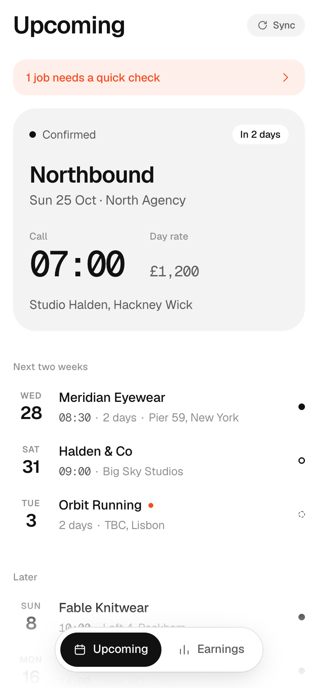
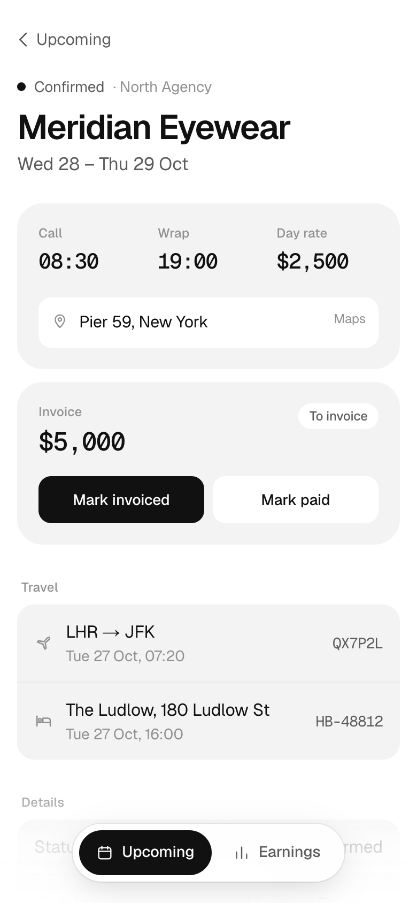
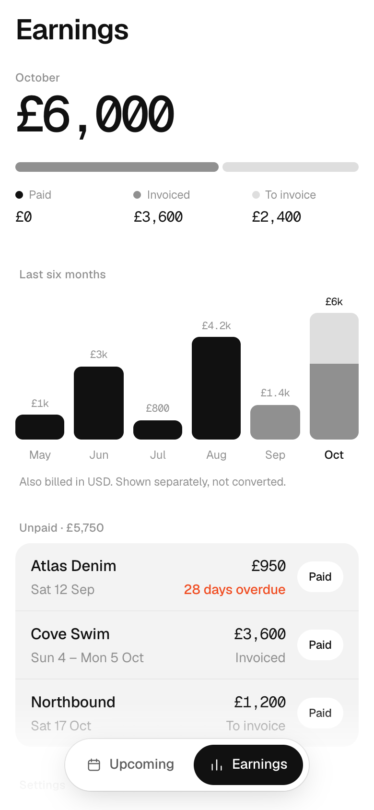

# Callsheet

**Bookings, call times and what I'm owed, read straight from my inbox.**

I work as a model. Jobs, options, travel and payments all arrive by email, and I never logged any of it. Callsheet reads those emails, turns each job into a record, reminds me the night before I'm on set, and shows what's still unpaid.

A booking lands in Gmail. Fifteen minutes later it's in the app with the right date, call time, location and rate.

<table>
  <tr>
    <td><picture><source media="(prefers-color-scheme: dark)" srcset="docs/screens/upcoming-dark.png"></picture></td>
    <td><picture><source media="(prefers-color-scheme: dark)" srcset="docs/screens/job-dark.png"></picture></td>
    <td><picture><source media="(prefers-color-scheme: dark)" srcset="docs/screens/earnings-dark.png"></picture></td>
  </tr>
  <tr>
    <td align="center">Upcoming</td>
    <td align="center">Job</td>
    <td align="center">Earnings</td>
  </tr>
</table>

## How it works

Every 15 minutes a cron pulls new mail from Gmail with read-only access. Anything that isn't from an agency or about a booking is skipped without opening it. The rest goes through two Claude calls, one to classify and one to extract fields against a strict schema. The result updates the matching job or creates a new one, and schedules its push reminders.

- **Null beats a guess.** Fields the email doesn't state are left empty and the job is flagged for review.
- **Updates edit, they don't duplicate.** A moved call time changes the existing job and sends a push saying what changed.
- **Reminders in the job's time zone.** Night before, two hours before call, and invoice nudges until paid.
- **Email bodies are never stored.** Only headers and the extracted fields are kept.

## Stack

Next.js 16, TypeScript, Tailwind, Postgres with Drizzle, Claude Haiku and Opus, web push. Hosted on Railway.

Setup and deployment are in [docs/SETUP.md](docs/SETUP.md). The original spec is in [docs/SPEC.md](docs/SPEC.md).
