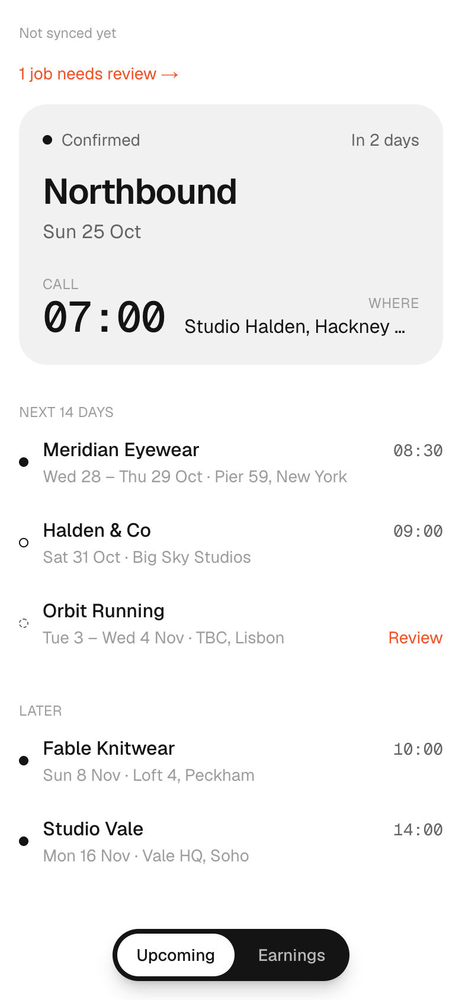
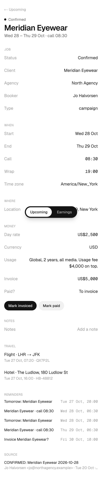
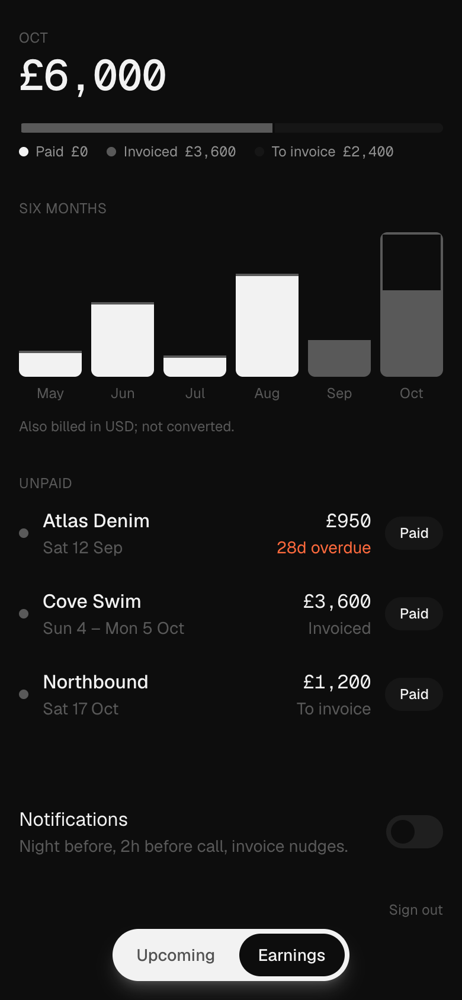

# Callsheet

Reads my booking emails, turns each job into a structured record, and pushes a reminder before I'm due on set.

A booking email lands in Gmail. Within 15 minutes it shows up in the app with the right date, call time, location and rate. I get a push the night before, and I can see what's unpaid at a glance.

Single user, installable PWA, deterministic pipeline. Full spec in [docs/SPEC.md](docs/SPEC.md); build log in [docs/TASKS.md](docs/TASKS.md).

<p>
  
  
  
</p>

## How it works

```
Gmail (read-only)
   │  every 15 min, history.list since last historyId
   ▼
 filter ── agency domain or booking words in the subject? ── no ──▶ stop at the headers
   │ yes
   ▼
 classify ── Haiku, one cheap call ──▶ new_booking | update | travel | payment | irrelevant
   │
   ▼
 extract ── Opus, Zod structured output, null over guess ──▶ job · travel[] · payment
   │
   ▼
 upsert ── match by thread id, then agency + client + date overlap
   │        write job / travel / invoice, diff changes, plan reminders
   ▼
 Postgres ──▶ PWA (Upcoming · Job · Earnings)
          └─▶ reminders table ── every 5 min ──▶ web push
```

- **No agent in the pipeline.** Two LLM calls per relevant email, both schema-constrained. Everything else is plain code with tests.
- **Bodies are never stored.** Only the Gmail id, headers and extracted fields are kept. Each record links back to its source email in Gmail.
- **Null beats a guess.** Missing or malformed fields are nulled and the job is flagged *Needs review* with the reasons; one tap clears it.
- **Updates change the job, not duplicate it.** An option becoming confirmed, or a call time moving, edits the existing row and sends a push saying what changed.
- **Reminders run in the job's own time zone.** Night before at 20:00, two hours before call, an invoice nudge the day after wrap, and overdue nudges weekly until paid.

## Stack

Next.js 16 (App Router) · TypeScript · Tailwind 4 · Postgres + Drizzle · Anthropic SDK · Railway (app, Postgres, cron) · Web Push (VAPID) · Vitest

## Running locally

Needs Node 20+, pnpm and Postgres.

```bash
pnpm install
cp .env.example .env.local      # then fill it in, see below
createdb callsheet_dev
pnpm db:migrate
pnpm seed:demo --reset          # optional: fake data to look at
pnpm dev
```

| Variable | How to get it |
|---|---|
| `DATABASE_URL` | Any Postgres. Neon or Supabase in production. |
| `GOOGLE_CLIENT_ID` / `GOOGLE_CLIENT_SECRET` | Google Cloud OAuth client, *Web application*. Keep the consent screen in Testing with yourself as the only test user, so no verification is needed. Add the Gmail API. |
| `GOOGLE_REDIRECT_URI` | `<origin>/api/auth/callback/google` |
| `ALLOWED_EMAIL` | The one address allowed to sign in. |
| `SESSION_SECRET` | `openssl rand -base64 32` |
| `TOKEN_ENCRYPTION_KEY` | `pnpm keygen` |
| `ANTHROPIC_API_KEY` | Anthropic console. |
| `NEXT_PUBLIC_VAPID_PUBLIC_KEY` / `VAPID_PRIVATE_KEY` | `pnpm vapid` |
| `CRON_SECRET` | Any random string. The cron services send it to the cron routes. |
| `AGENCY_DOMAINS` | Comma-separated sender domains that are always read. |

Sign in at `/sign-in`, then pull down on Upcoming to run the first sync. Turn on notifications from the Earnings screen. On iPhone, add the app to the home screen first; iOS only allows web push for installed PWAs (16.4+).

## Tests and the extractor eval

```bash
pnpm db:test:setup    # once: creates and migrates callsheet_test
pnpm test             # unit + database tests, offline
pnpm eval:offline     # checks every fixture pair against the schema
pnpm eval             # runs classify + extract over the 22 fixtures; needs ANTHROPIC_API_KEY
```

`fixtures/` holds 22 fictional booking emails with expected output, covering options, confirmations, updates on the same thread, travel, payment and noise. `pnpm eval` prints per-field accuracy and fails if labels or any required field drop below 90%. Override `CLASSIFY_MODEL` / `EXTRACT_MODEL` to compare cost against accuracy.

## Layout

```
src/app/(app)/        Upcoming, Job detail, Earnings, Needs review
src/app/api/          OAuth, cron (sync, reminders), push subscribe
src/lib/              gmail · filter · classify · extract · upsert · reminders · overdue · push · pipeline
src/db/               Drizzle schema and client
drizzle/              migrations
fixtures/             eval set
scripts/              seed, eval, keygen, vapid, screenshots
public/sw.js          push service worker
```

## Security

- Gmail scope is `gmail.readonly` only. The OAuth app stays in Testing mode.
- The refresh token is AES-256-GCM encrypted at rest; the key lives only in the environment.
- Every route needs a signed session for the allow-listed email, except sign-in, the OAuth callback, the cron routes (which check `CRON_SECRET`), the service worker and the manifest.
- Email bodies go to the model for extraction and nowhere else.

## Deploying

Railway, three services from this repo plus Postgres:

| Service | Config file | Runs |
|---|---|---|
| `web` | `railway.json` | Builds the app, applies migrations before each deploy, serves it. |
| `cron-sync` | `railway/cron-sync.json` | Every 15 min: calls `/api/cron/sync`, then exits. |
| `cron-reminders` | `railway/cron-reminders.json` | Every 5 min: calls `/api/cron/reminders`, then exits. |

1. Create a project, add Postgres, and add the repo three times, naming the services as above. Set each cron service's config file path in its settings.
2. On `web`, set the variables from `.env.example`, with `DATABASE_URL=${{Postgres.DATABASE_URL}}`. Generate a domain and set `GOOGLE_REDIRECT_URI` to `https://<domain>/api/auth/callback/google`, and add the same URI to the Google OAuth client.
3. On both cron services, set `APP_URL=https://${{web.RAILWAY_PUBLIC_DOMAIN}}` and `CRON_SECRET=${{web.CRON_SECRET}}`.

## Status

v1 milestones 1 to 4 are built. Phase 2 has started: a read-only tool API at `/api/tools/*` (`list_jobs`, `get_job`, `earnings`, `unpaid`, `draft_invoice_chase`) for an agent runtime, authenticated by `AGENT_TOKEN`. The Telegram bot on Hermes or OpenClaw is next.
